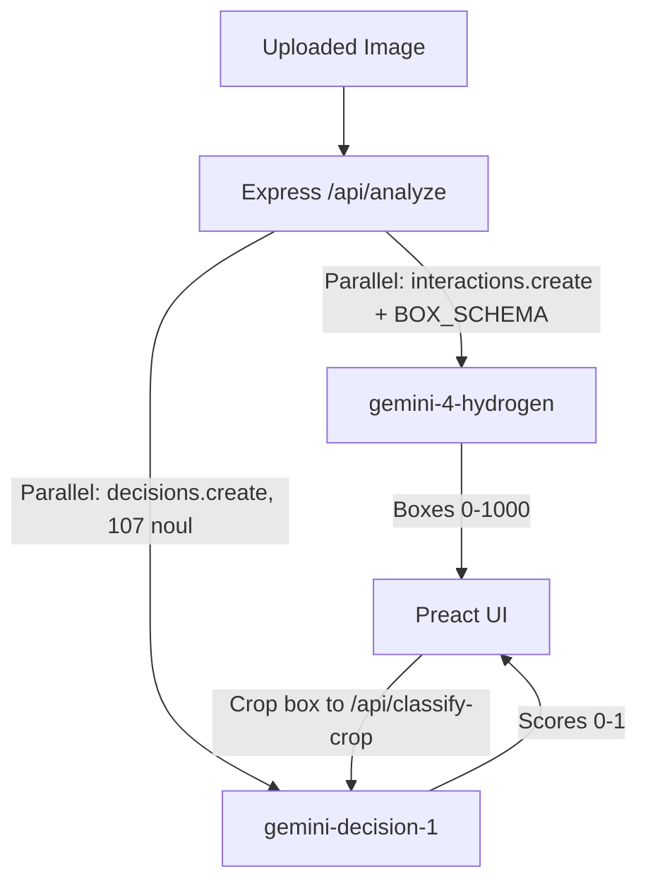
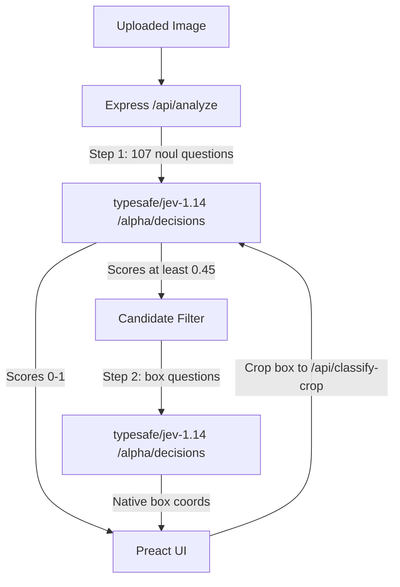

# Traffic Sign Categorizer

**Problem:** Identifying and localizing multiple small, distant, or overlapping traffic signs across a large closed-set taxonomy in real-world street photos is unreliable with single-pass image classification and difficult to calibrate with free-form LLM prompts.

**Solution:** This application combines calibrated `noul` (yes/no) decision-model scoring across 107 traffic sign classes with bounding-box localization and interactive crop-level re-classification across both Google Gemini and Jev 1.14.

## Purpose of the Experiment

This experiment compares **Google's Decision Model** (`gemini-decision-1`) and **Jev** (`typesafe/jev-1.14` on OpenRouter) using images as input. Specifically, it evaluates:

- **Calibrated closed-set classification:** How accurately and quickly each decision model scores 107 `noul` (yes/no) questions in a single forward pass on full street photos and cropped sign regions.
- **Spatial localization:** How each provider handles finding *where* traffic signs are in the image—comparing Jev's native `box` question type against Google's two-model workaround.

---

## Architecture

Both providers expose the same backend contract (`POST /api/analyze` for full-image localization + classification, and `POST /api/classify-crop` for re-classifying a cropped bounding box) and share the same 107-sign taxonomy in [`data/traffic_signs.json`](data/traffic_signs.json). However, their internal pipelines differ significantly.

### Google Gemini Pipeline (`TrafficSignService`)

Google's implementation runs **two separate models in parallel** (`Promise.all` in `POST /api/analyze`):

1. **Localization (`gemini-4-hydrogen`):** Calls `interactions.create` with a structured JSON schema (`BOX_SCHEMA`) instructing the model to return normalized `[0..1000]` `(ymin, xmin, ymax, xmax)` bounding boxes and a short `hintLabel` for every visible sign.
2. **Classification (`gemini-decision-1`):** Calls `decisions.create` (`v1beta`) with the image and all 107 `type: "noul"` questions (`"Is <sign.prompt> clearly visible in this image?"`) in one forward pass.
3. **Crop Re-classification:** The Preact UI crops any detected box on a canvas and posts it to `POST /api/classify-crop`, running `gemini-decision-1` again on the isolated sign.



### Jev 1.14 Pipeline (`JevSignService`)

Jev's implementation uses **a single model** (`typesafe/jev-1.14`) via OpenRouter's Alpha Decisions API (`POST https://openrouter.ai/api/alpha/decisions` with `TypeSafe-Danger-Zone-Images: true`) in a **two-step sequential flow**:

1. **Classification (`type: "noul"`):** Sends the image and all 107 `type: "noul"` questions to `/alpha/decisions` to obtain calibrated `[0..1]` scores.
2. **Localization (`type: "box"`):** Filters candidate signs with `score >= 0.45`, then sends a second `/alpha/decisions` request containing `type: "box"` questions (`"Locate <sign.prompt>"`) for those candidates. Jev returns `{ top, left, bottom, right }` in `[0..1]`, which the server scales to `[0..1000]`.
3. **Crop Re-classification:** Sends any user-selected crop to `POST /api/classify-crop`, running the same `type: "noul"` pass on the cropped image.

**Why two sequential calls instead of one?** Sending all 107 `noul` + 107 `box` questions (214 total) in the first request would force Jev to compute bounding boxes for ~100+ absent signs, inflating payload size and latency. Filtering by `score >= 0.45` first limits `box` queries to likely candidates and avoids noisy boxes for non-present classes.



---

## The `box` Question Type in Jev (and Google's Extra-LLM Workaround)

### Why `box` in Jev is Unique and Important

Standard decision models only output scalar probabilities or discrete choices (`noul`, `choice`, etc.). Jev's Decisions API uniquely supports `type: "box"` as a **first-class decision question type** alongside `noul`:

- **Unified API & model:** The same model (`typesafe/jev-1.14`) and endpoint (`/alpha/decisions`) handle both *"Is this sign present?"* (`noul`) and *"Where is this sign?"* (`box`), returning structured `{ top, left, bottom, right }` coordinates without prompt-engineering JSON schemas or parsing raw text.
- **Critical for small/distant objects:** In wide street photos, a speed-limit or warning sign may occupy only a tiny fraction of the frame, lowering whole-image `noul` confidence. Having `box` localization enables the UI to isolate and crop each sign so it can be re-scored at high resolution and visually verified by the user.

### Implementing Localization for Google with an Extra LLM

Google's `gemini-decision-1` (`decisions.create`) currently only supports decision/classification questions (`noul`) and has **no native `box` question type**. To achieve feature parity and support crop-and-reclassify for Google:

- We had to introduce an **extra multimodal LLM** (`gemini-4-hydrogen`) via `interactions.create` with a strict `BOX_SCHEMA` (`response_format`) to extract `[ymin, xmin, ymax, xmax]` coordinates.
- This requires maintaining two separate SDK calls (`interactions` + `decisions`), running them in parallel to hide latency, and parsing structured JSON output from the localization LLM before the UI can crop signs for `gemini-decision-1`.

---

## Installation & Usage

### Prerequisites

- **Node.js** 18+ and `npm`
- **Your own API key (BYOK):**
  - A **Google Gemini API key** (`AIza...`) for **Gemini (H4 + D1)**, and/or
  - An **OpenRouter API key** (`sk-or-v1-...`) for **Jev 1.14 (OpenRouter)**

### Security & BYOK Design

- **Zero Server-Side Key Storage:** The Express server (`server/`) never reads `.env` or stores API keys. Every `/api/validate-key`, `/api/analyze`, and `/api/classify-crop` request requires `X-Provider` (`gemini` | `jev`) and `X-API-Key` headers (query-string keys are rejected with `HTTP 400`).
- **Browser-Only Key Persistence:** Validated keys are stored locally in your browser's **IndexedDB** (`traffic-sign-categorizer-byok`) and can be removed anytime via **Forget Key**.
- **Error Scrubbing & Security Headers:** Upstream errors scrub `AIza...`, `sk-or-v1-...`, `Bearer` tokens, and raw keys before reaching clients; responses include `CSP`, `X-Frame-Options: DENY`, and `Cache-Control: no-store` on `/api/*`.

### Setup

```powershell
cd traffic-sign-categorizer
npm install
```

Review [`config.json`](config.json) if you want to adjust model IDs, OpenRouter timeout, or the default UI confidence threshold (`default_threshold_pct`). No `.env` file is required.

### Running the App

Start the backend server and Vite frontend in two terminals:

```powershell
# Terminal 1: Express API server (http://localhost:3002)
npm run server

# Terminal 2: Vite + Preact UI (http://localhost:5174, proxies /api -> :3002)
npm run dev
```

Open `http://localhost:5174`, enter and validate your Gemini and/or OpenRouter API key in the **Bring Your Own Key (BYOK)** panel, upload a street/traffic-sign image, and click detected bounding boxes to crop and re-classify individual signs.

### Typecheck & Production Build

```powershell
npm run build
```
